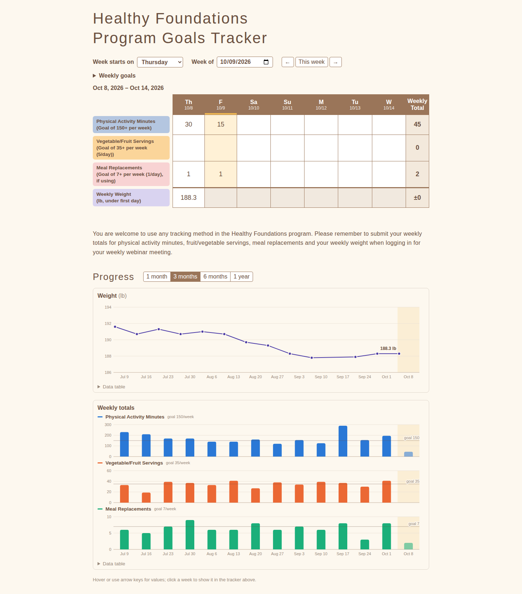
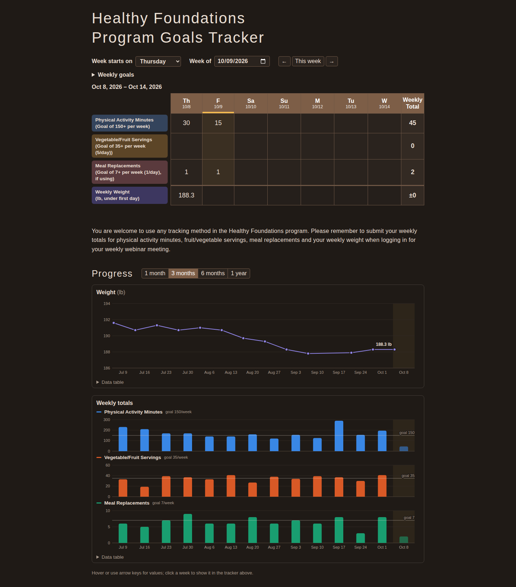
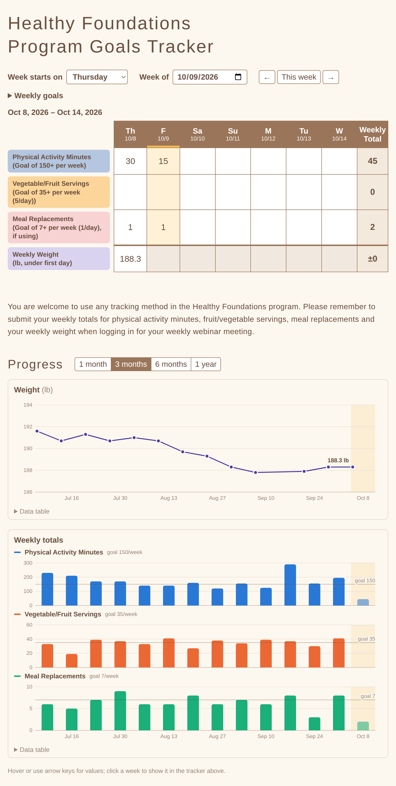
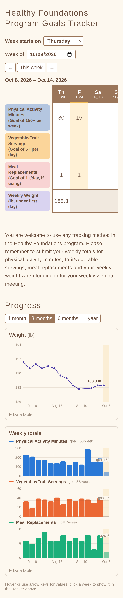

HF-tracking
===========

A small web version of the *Healthy Foundations Program Goals Tracker* PDF.  Each day has
editable numeric fields for physical activity minutes, vegetable/fruit servings and meal
replacements; the last column is the weekly total.  The first day of the week is configurable
(default Thursday, stored in the database) and a date picker / prev / next buttons choose which
week to view (default: the current week).  Values save automatically as you type.
The weekly goals (activity minutes, vegetable/fruit servings, meal replacements; defaults
150 / 35 / 7) are set in the "Weekly goals" panel under the week controls and drive the row
labels and the chart goal lines; 0 means no goal.

A weekly weight is entered under the first day of the week; its "total" cell shows the change
since the previous weigh-in.  Below the tracker, a **Progress** section charts weight over time
and the weekly totals of the three daily metrics (one small panel each, since their scales
differ, with the weekly goal drawn as a line) over 1 month, 3 months, 6 months or 1 year.
Hover (or focus a chart and use the arrow keys) for values; click a week to show it in the
tracker.  Each chart has a "Data table" view.  The page follows the OS light/dark setting.

The service runs in a singularity container (like graphite-api-singularity):
nginx serves the static HTML5 page and runs a small Python CGI JSON API through fcgiwrap,
which stores data in sqlite3.

# Screenshots
Sample data, 3-month chart view.

**Desktop** (1440px)



**Desktop, dark mode** (follows the OS setting)



<table>
<tr><th>Tablet (820px)</th><th>Phone (390px)</th></tr>
<tr>
<td valign="top"></td>
<td valign="top"></td>
</tr>
</table>

On a phone the daily table scrolls sideways with the row labels pinned; the charts fit the screen.

# Layout
* `www/` -> `/srv/www` (read-only): the page (`index.html`, `app.js`, `charts.js`, `style.css`) and `cgi-bin/api.py`
* `var/` -> `/var/hf`: `data/tracker.db` (sqlite3), `log/` (nginx + fcgiwrap logs), `run/` (socket, pid, temp)
* `conf/` -> `/etc/hf` (read-only): `nginx.conf` — edit the port/listen address here, no rebuild needed
* `hf-tracker.def`: singularity definition (ubuntu 24.04 + nginx-light, fcgiwrap, python3, sqlite3)
* `bin/hf-start`: entrypoint inside the container; runs fcgiwrap + nginx as the invoking user.
  Baked into the image, and also bind-mounted by `bin/hf-container` so edits apply on restart.
  It takes a lock in `var/run/` and refuses to start if another copy is already using that var dir.
* `bin/hf-container`: start/stop/status wrapper for the singularity instance
* `bin/hf-backup`: backup/restore of the sqlite db (see below)
* `systemd/hf-tracker-container.service`: unit file calling `bin/hf-container`

The tracker rows are defined in `METRICS` (daily rows, with the default `weekly_goal`) and `WEIGHT`
(label and unit) at the top of `www/cgi-bin/api.py`; the page builds itself from those.

**There is no authentication.** nginx listens on `127.0.0.1:8577` by default. To reach it from
other machines, change `listen` in `conf/nginx.conf` (or put an authenticating reverse proxy in front).

# Singularity
```
sudo singularity build hf-tracker.sif hf-tracker.def
bin/hf-container start          # http://127.0.0.1:8577/
bin/hf-container status
bin/hf-container stop
```
(`--fakeroot` builds don't work on this host; use sudo.)  The timezone is set in `%environment`
of the def file (America/Los_Angeles); it only affects log timestamps — "today"/"this week" come
from the browser's local time.

As a service (edit the paths and User/Group in the unit file first):
```
sudo cp systemd/hf-tracker-container.service /etc/systemd/system/
sudo systemctl daemon-reload
sudo systemctl enable hf-tracker-container.service --now
```

# Data
```
sqlite3 var/data/tracker.db 'SELECT * FROM entries ORDER BY day'
```
Tables: `entries(day, metric, value, updated)` keyed by (day, metric) - weight is the `weight` metric
on the week's first day - and `settings(key, value)`: `start_day` and `goal_<metric>` (weekly goals
set on the page; missing keys fall back to the defaults in `api.py`).
Data is stored per calendar day, so changing the start day just re-slices the same data into
different weeks.

# Backup / restore
`bin/hf-backup` runs on the host (python3 only, no container) and is safe while the service is
running: it uses sqlite's online backup API rather than copying the file.
```
bin/hf-backup backup [--keep 30]      # gzipped, integrity-checked snapshot in backups/; quiet on success
bin/hf-backup list
bin/hf-backup restore latest          # or a file name from `list`; asks first (--yes for scripts)
```
Restore verifies the backup, snapshots the current data as `tracker-...-pre-restore.db.gz`
(never pruned by `--keep`), then writes the backup into the live database; no restart needed.
`--db`/`--dir` (or `HF_DB`/`HF_BACKUP_DIR`) override the defaults.  Nightly via cron:
```
30 2 * * * /home/<USER>/git-work/HF-tracking/bin/hf-backup backup --keep 60
```
Errors go to stderr with a non-zero exit, so cron mails you only when something fails.  Backups
live inside the repo dir by default; point `--dir` at another disk if you want them off this one.

# Testing changes
Never point a test container at the live `var/`: use a separate var dir, conf (different port)
and instance name, e.g.
```
mkdir -p .testvar/conf
sed 's/listen .*;/listen 127.0.0.1:8578;/' conf/nginx.conf > .testvar/conf/nginx.conf
singularity instance start --bind "$PWD/www:/srv/www:ro,$PWD/.testvar:/var/hf,$PWD/.testvar/conf:/etc/hf:ro,$PWD/bin/hf-start:/usr/local/bin/hf-start:ro" hf-tracker.sif hf-test
...
singularity instance stop --force hf-test; rm -rf .testvar
```
